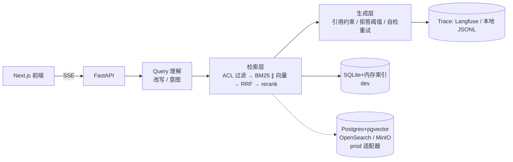

# DocuMind

带证据链和拒答能力的企业知识库问答系统。每个答案都能点回原文的具体页和段落；答不出来时明确说"文档里没有"；
每次改动都有一份可对比的评测报告。

**状态：开发中（P0 竖切已跑通，评测报告见 `evals/reports/`）**

## 为什么通用 RAG 在企业里跑不通（三个具体失败模式）

1. **答不出还硬答**：招聘制度里没有"年假折现"条款，通用 RAG 会拿相邻的休假条款凑一个看起来合理的答案。
   在制度问答场景里，一次编造的"可以折现"足以让 HR 背锅。
2. **有答案但点不回去**：回答"试用期最长六个月"却给不出第几章第几条，业务方无法核对，等同于不可用。
3. **无权的人也能问出来**：先检索全部文档、生成后再过滤，模型已经读过无权内容——内容会泄露在答案里，
   也会泄露在日志与 trace 里。

本项目的三个对应设计：**证据链（页/字符 span 级引用）**、**拒答阈值由评测集标定**、**ACL 在检索阶段生效**。

## 架构



数据层在 dev 用 SQLite + 进程内索引（clone 下来零依赖可跑），检索/存储/向量三处都是接口，
换 Postgres+pgvector / OpenSearch / MinIO 只改配置。见 `docs/adr/`。

## 快速开始

```bash
uv sync
uv run documind ingest evals/datasets/zhicheng_suhao.pdf --acl all
uv run documind ask "公司注册资本是多少" --user alice
uv run documind serve            # http://127.0.0.1:8080/docs
uv run documind eval --strategy structure
```

前端：

```bash
cd web && npm install && npm run dev
```

## 评测

见 `evals/README.md`。四种切块策略在同一份 50–100 条自建问答集上的对比见 `evals/reports/ablation.md`。

## 已知限制

- dev 后端是 SQLite + 进程内 BM25/向量索引，单机、单进程；多副本需换 OpenSearch/pgvector（接口已留）。
- docling 解析器是可选适配器，默认走 pypdf（保留精确字符偏移，便于 span 高亮）。扫描件 OCR 未接。
- Langfuse 未配置 key 时 trace 落本地 JSONL，字段与 Langfuse 对齐。
- 表格问答、增量索引、多租户在 P1。