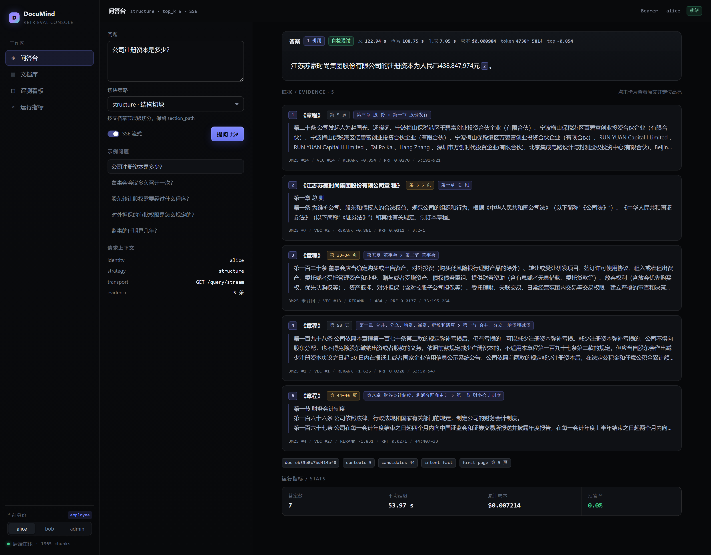
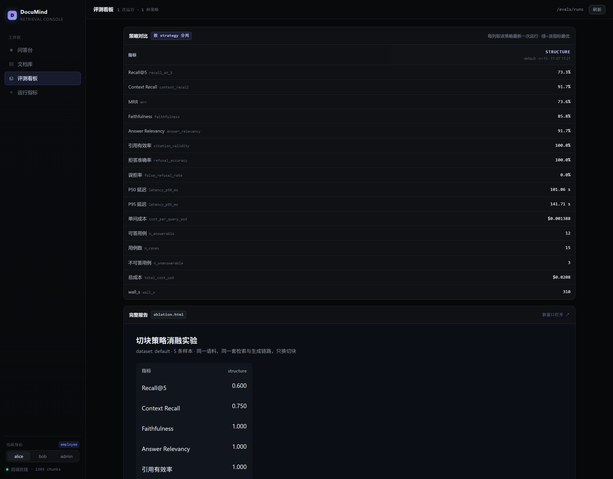
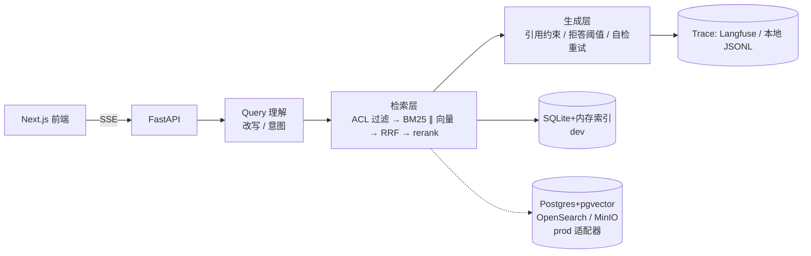

# DocuMind

带证据链和拒答能力的企业知识库问答系统。每个答案都能点回原文的具体页和段落；答不出来时明确说"文档里没有"；
每次改动都有一份可对比的评测报告。

**状态：开发中（P0 竖切已跑通，评测报告见 `evals/reports/`）**

## 界面

问答台：一句"公司注册资本是多少？"，答案带 1 条引用（`[2]` → 章程第 3 页第六条），右侧 5 张证据卡各自可点开原文并高亮原句。



评测看板：按 strategy 分列的最新一次运行对比，指标最优格标 ▲，下方直接内嵌 `ablation.html` 报告。



两张图都是本机 `next start` + `uvicorn` 实跑截图（`docs/assets/`），不是设计稿。

## 为什么通用 RAG 在企业里跑不通（三个具体失败模式）

1. **答不出还硬答**：招聘制度里没有"年假折现"条款，通用 RAG 会拿相邻的休假条款凑一个看起来合理的答案。
   在制度问答场景里，一次编造的"可以折现"足以让 HR 背锅。
2. **有答案但点不回去**：回答"试用期最长六个月"却给不出第几章第几条，业务方无法核对，等同于不可用。
3. **无权的人也能问出来**：先检索全部文档、生成后再过滤，模型已经读过无权内容——内容会泄露在答案里，
   也会泄露在日志与 trace 里。

本项目的三个对应设计：**证据链（页/字符 span 级引用）**、**拒答阈值由评测集标定**、**ACL 在检索阶段生效**。

## 架构



数据层在 dev 用 SQLite + 进程内索引（clone 下来零依赖可跑）；检索口径有端口且后端可注入
（`IndexStore.get(keyword_builder=..., vector_builder=...)`，默认 `BM25Index` / `VectorIndex`），
但换 Postgres+pgvector / OpenSearch 仍需改 4 处（清单见 `docs/adr/0002-hybrid-retrieval.md`），不是只改配置。见 `docs/adr/`。

## 快速开始

```bash
uv sync
uv run documind ingest evals/datasets/zhicheng_suhao.pdf --acl all
uv run documind ask "公司注册资本是多少" --user alice
uv run documind serve            # http://127.0.0.1:8080/docs
uv run documind eval --strategy structure
```

前端：

```bash
cd web && npm install && npm run dev
```

## 评测结果

四种切块策略跑同一条链路（ACL → BM25 ∥ 向量 → RRF → cross-encoder 重排 → 引用约束生成），
同一批题（每策略 20 条可答 + 8 条不可答，共 112 次评测），语料是 166 页公开公司章程，
被测与 judge 都是 `qwen3.8-flash`，embedding / rerank 是本地 bge：

| 指标 | fixed | semantic | structure | parent_child |
|---|---|---|---|---|
| Recall@5 | 0.950 | 0.950 | 0.900 | 0.950 |
| Context Recall | 0.900 | 0.750 | 0.900 | 0.950 |
| Faithfulness | 0.834 | 0.892 | 0.938 | 0.880 |
| Answer Relevancy | 0.850 | 0.950 | 0.950 | 0.900 |
| 引用有效率 | 1.000 | 1.000 | 0.975 | 1.000 |
| 拒答准确率 | 1.000 | 1.000 | 1.000 | 1.000 |
| 误拒率 | 0.150 | 0.050 | 0.000 | 0.050 |
| P95 延迟(ms)* | 150813 | 120718 | 127578 | 73507 |
| 单问成本($) | 0.0009 | 0.0010 | 0.0011 | 0.0012 |

> 该表生成于 focus 重排改造之前（head@512×30）；structure 列已用 focus@256×10 重跑：Recall@5 与 Context Recall 均为 0.950（19/20），见 `docs/RERANK-PERF.md §4`。

**一句话结论：切块策略几乎不影响 Recall@5（0.90 vs 0.95，20 题里只差 1 题），
它影响的是"喂给模型的上下文完不完整"和"答案有没有原文依据"——Context Recall 0.75 → 0.95、
Faithfulness 0.834 → 0.938，以及按页切块把条款切断后那 15% 的误拒。**

\* 延迟是在 3 worker × 2 并发的评测负载下测的，含本地 rerank 排队；focus@256×10 实测单问串行约 9.5s、重排 P50 2.7s（`docs/RERANK-PERF.md §5`）。
完整的逐题明细、拒答阈值 P-R 曲线和口径说明见 `evals/reports/ablation.md`。

复现：

```bash
./.venv/Scripts/python.exe -u scripts/run_ablation_parallel.py \
    --ans-limit 20 --unans-limit 8 --workers 3 --concurrency 2
```

## 评测

评测集的构建、指标口径和"诚实边界"见 `evals/README.md`；四种切块策略的详细对比见 `evals/reports/ablation.md`。

## 已知限制

- dev 后端是 SQLite + 进程内 BM25/向量索引，单机、单进程；多副本需换 OpenSearch/pgvector。
  检索层的后端注入点已经留好：`IndexStore.get(keyword_builder=..., vector_builder=...)`
  （默认 `BM25Index` / `VectorIndex`，契约见 `index.KeywordStore` / `VectorStore`，
  可替换性由 `tests/test_ports.py::test_retrieval_runs_on_injected_fake_stores` 钉住）。
  但**只有检索这一段可换**：`chunks.embedding` 的 BLOB 列与全表 `vstack` 组装仍在 dev 侧，
  换后端还要改这几处，清单见 `docs/adr/0002-hybrid-retrieval.md`。
- DoclingParser 存在但未接线（`DOCUMIND_PARSER=docling` 会在配置校验阶段直接报错），默认走 pypdf（保留精确字符偏移，便于 span 高亮）。扫描件 OCR 未接。
- Langfuse 未配置 key 时 trace 落本地 JSONL，字段与 Langfuse 对齐。
- 表格问答、增量索引、多租户在 P1。
- 语料只有 3 份上市公司章程（166 页公开文件），切块结论不外推到合同/代码/工单。
- `docker-compose.yml` 面向生产形态，本机 Windows 无 Docker，**未实跑验证**；CI 走的是 dev 后端。
- 评测集是 LLM 合成 + 人工抽检，不是真实用户日志；judge 与被测同模型，存在自评偏差。

## Roadmap

| 阶段 | 内容 | 判断"该做"的信号 |
|---|---|---|
| P1 | 答案自检重试默认开启 + 反馈回流（点赞/纠错进评测集） | 用户开始真实使用 |
| P1 | 表格/图表问答（换 docling 或接 table transformer） | 语料里出现表格类问题 |
| P1 | 增量索引（sha256 变更 + 文档级重建） | 文档数 > 1 万页或日更 |
| P2 | GraphRAG：多跳关系问题（"A 条款引用的 B 条款是否被修订过"） | 比较型/流程型问题占比上升 |
| P2 | 按部门多租户（tenant_id 进 ACL 与索引分片） | 第二个部门要用 |

## 一键验收

```bash
bash scripts/verify.sh      # ruff + pytest + 检索门禁（离线，不下载模型）
```